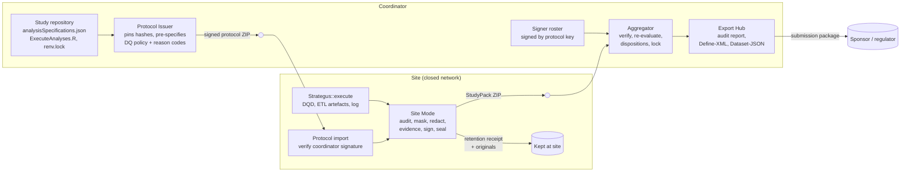

# Computerised system validation plan — template

Template for validating OHDSI Study Studio for use in a study run with **regulatory** assurance.
Fields in `‹…›` are filled in by the organisation that uses the tool (sponsor or network coordinator).
Requirement IDs (R1.1 …) refer to [requirements.md](requirements.md).

Basis: risk-based validation as described in FDA *Electronic Systems, Electronic Records, and Electronic
Signatures in Clinical Investigations: Q&A* (Q7–Q8), EMA *Guideline on computerised systems and electronic
data in clinical trials* (§4.10, Annex 2) and ICH E6(R3) §4.3.4.

| | |
|---|---|
| Study | ‹study ID and title› |
| System | OHDSI Study Studio ‹version› — single file `index.html`, SHA-256 ‹hash› |
| Validation owner | ‹name, role› |
| Plan version / date | ‹1.0 / YYYY-MM-DD› |

---

## 1. Purpose and scope

This plan establishes that OHDSI Study Studio, as configured for ‹study›, is fit for its intended use and
that the records it produces are accurate, attributable, complete and protected against undetected change.

**In scope:** protocol issuance and signing; site-side audit, masking, evidence evaluation, signing and
sealing of StudyPacks; coordinator-side verification, signer roster, site disposition, audit report and
CDISC export.

**Out of scope (validated separately or by their owners):** the OMOP CDM ETL and database; OHDSI HADES /
Strategus packages and the R environment pinned by `renv.lock`; the Data Quality Dashboard; the web
browser and operating system (recorded, see §7.1); the transport of files between sites and the coordinator.

## 2. Intended use

| Aspect | Description |
|---|---|
| Users | Site operators and site PIs (Site Mode); network coordinator (Admin Mode) |
| Records created | StudyPack (`manifest.json`, `manifest.jws.json`, `audit_report.json`, …), retention receipt, signer roster + signature, disposition log + signed head, audit report, submission package |
| Regulatory use | ‹e.g. re-examination application (再審査申請) / safety study under ICH M14 / supporting evidence in an NDA› |
| GxP impact | Determines which sites' results enter the analysis and what is submitted: **high** |
| Configuration | `study_config.json`: `assurance: regulatory`, data-quality policy, CDM requirements and reason codes pinned by the protocol and signed by the coordinator |

## 3. System description and data flow

Everything runs in the browser from one HTML file. A Content-Security-Policy with `connect-src 'none'`
and a runtime guard block all network access; nothing is stored between sessions.

Transfers between the boxes (‹USB media / secure file transfer / …›) are outside the tool. Their integrity
is verified by the tool on arrival (manifest hashes, signatures), not assumed.

## 4. Roles and responsibilities

| Role | Responsibilities |
|---|---|
| Sponsor / network coordinator | Owns this plan; issues and signs the protocol; verifies signer identities and maintains the signed roster; records and locks dispositions; retains the disposition log head in the TMF |
| Site operator | Runs Strategus and DQD; seals and signs the StudyPack; keeps the retention receipt and originals |
| Site PI | Approves release of the StudyPack (second signature, where the protocol requires it) |
| Tool maintainer | Releases versions with release notes and the SHA-256 of `index.html`; maintains the automated test suite |
| QA | Reviews this plan, the test evidence and deviations; performs periodic review |

## 5. Risk assessment

Severity (S), probability (P) and detectability (D): 1 = low … 3 = high. Risk = S × P × D.
Residual risk is assessed after the controls.

| # | Function | Failure | S | P | D | Risk | Controls | Verified by | Residual |
|---|---|---|---|---|---|---|---|---|---|
| 1 | Small-cell audit | Count 0 < n < min leaves the site | 3 | 2 | 2 | 12 | RDMS-driven audit, library refuses to seal, coordinator re-audit | `cellAuditor.test.ts`, `strategus.test.ts` (Strategus results), `builder.test.ts` | Low |
| 2 | Masking record | Original values recoverable from the pack | 3 | 2 | 3 | 18 | Salted commitments; salts only in the site receipt | `commitment.test.ts`, `aggregator.test.ts` (signs, verifies …) | Low |
| 3 | Sealing | Change after sealing goes undetected | 3 | 2 | 1 | 6 | SHA-256 manifest of every file | `aggregator.test.ts` (detects tampering …) | Low |
| 4 | Protocol conformance | Site runs different code or settings | 3 | 2 | 2 | 12 | Pinned hashes, protected section, sealed protocol copy | `strategus.test.ts` (protected section), `aggregator.test.ts` (cross-site) | Low |
| 5 | Signatures | Forged or misattributed signature | 3 | 1 | 2 | 6 | ES256 JWS over manifest bytes; kid ↔ key check; roster enrollment | `signer.test.ts` | Low |
| 6 | Signer roster | Roster altered to enroll an attacker's key | 3 | 2 | 2 | 12 | Roster signed by the protocol issuer key with meaning `roster-approved`; changes invalidate it | `signer.test.ts` (roster trust), `aggregator.test.ts` (regulatory demo set) | Low |
| 7 | Key compromise | Revoked key used with a back-dated clock | 3 | 1 | 2 | 6 | Revocation judged by coordinator receipt time | `signer.test.ts` (revocation …) | Medium — depends on prompt revocation (SOP) |
| 8 | Data quality | Unfit data enters the analysis | 3 | 2 | 2 | 12 | Pre-specified DQD gate scoped to study tables | `dqdAuditor.test.ts`, `readiness.test.ts` | Medium — DQD does not reconcile source vs CDM |
| 9 | Provenance | Results from another CDM / vocabulary build | 2 | 2 | 2 | 8 | cdm_source vs DQD vs ETL vs protocol requirements | `provenance.test.ts` | Low |
| 10 | Execution log | Credentials leave the site / errors unnoticed | 2 | 2 | 2 | 8 | Redaction with commitment; error/warning audit | `logAuditor.test.ts` | Medium — pattern-based redaction (review the redacted log) |
| 11 | Time | Wrong or altered clocks | 2 | 2 | 3 | 12 | Sourced times, ordering checks, trusted window | `provenance.test.ts` (timeline) | **High — no trusted clock offline (documented limitation)** |
| 12 | Disposition | Selection bias / undocumented exclusion | 3 | 2 | 2 | 12 | Pre-specified reason codes, justification for deviations, lock before export | `dispositionLog.test.ts`, `regulatory.test.ts` | Low |
| 13 | Audit trail | Entries changed or removed | 3 | 1 | 2 | 6 | Hash chain, signed head, head retained in TMF | `dispositionLog.test.ts` | Medium — depends on retaining the head (SOP) |
| 14 | Export | Submission content differs from adopted packs | 3 | 1 | 2 | 6 | Export manifest hashes; per-site manifests and audit reports included | `regulatory.test.ts`, `cdisc.test.ts` | Low |
| 15 | Network isolation | Data sent off the device | 3 | 1 | 2 | 6 | CSP `connect-src 'none'`, runtime network guard | ‹UI test or manual check: network panel shows no requests› | Low |

## 6. Requirements → verification traceability

| Req. | Verified by (automated) |
|---|---|
| R1.1–R1.3 | `signer.test.ts` › detached JWS › *verifies, records meaning/time/zone, and fails on any payload change* |
| R1.4 | `signer.test.ts` › key file › *rejects short passphrases*, *unlocks with the right passphrase only*, *detects a key file whose public key was swapped* |
| R1.5 | `signer.test.ts` › *supports several signers and checks the roster*, *judges revocation by the coordinator receipt time*, signer roster trust; `aggregator.test.ts` › regulatory demo set |
| R1.6 | `signer.test.ts` › jwkThumbprint (RFC 7638), *rejects a header whose embedded key does not match its kid* |
| R2.1–R2.2 | `provenance.test.ts` › timeline (all) |
| R2.3 | `regulatory.test.ts` › disposition audit trail in the submission |
| R3.1–R3.4 | `provenance.test.ts` › cdm_source and software provenance (all) |
| R4.1–R4.5 | `dqdAuditor.test.ts` (all); `readiness.test.ts` › *turns regulatory evidence findings into blockers*; `builder.test.ts` › *refuses evidence that blocks* |
| R5.1 | `logAuditor.test.ts` › auditLog; `readiness.test.ts` › regulatory evidence |
| R5.2–R5.4 | `logAuditor.test.ts` › redactLog; `commitment.test.ts` (all); `aggregator.test.ts` › *signs, verifies against the roster …* (retention receipt) |
| R6.1–R6.2 | `dispositionLog.test.ts` › *requires identity, a pre-specified reason, and justification for overrides*, *chains entries* |
| R6.3 | `dispositionLog.test.ts` › *refuses decisions after lock*; `regulatory.test.ts` › disposition audit trail (export refused before lock / with undecided sites) |
| R6.4–R6.5 | `regulatory.test.ts` › disposition audit trail in the submission; `dispositionLog.test.ts` › *detects an edited, removed or truncated entry* |

## 7. Qualification

### 7.1 Installation qualification (IQ)
At every site and at the coordinator, per release:
1. Obtain `index.html` for version ‹version› from ‹release location›.
2. Compute its SHA-256 (`sha256sum index.html` / `certutil -hashfile index.html SHA256`) and compare it with the released hash ‹hash›.
3. Record the browser name and version and the operating system.
4. Open the file and confirm the header shows **Offline · Zero-Transmission** and the expected version.

Acceptance: hash matches; browser is a supported version (‹list›).

### 7.2 Operational qualification (OQ)
1. **Automated suite** (tool maintainer, per release): `npm ci && npm test` on the tagged release, with JUnit
   output kept as evidence (`npx vitest run --reporter=junit --outputFile=oq-results.xml`). Acceptance: all tests pass.
2. **Scripted UI scenarios** on the released `index.html` with `samples/regulatory/` (demo passphrase `demo-passphrase-not-secret`):

| ID | Scenario | Expected result |
|---|---|---|
| OQ-UI-1 | Issue a regulatory protocol without unlocking the coordinator key | Issue is blocked |
| OQ-UI-2 | Site: load the regulatory protocol ZIP | Coordinator signature shown as valid with the issuer's fingerprint |
| OQ-UI-3 | Site: load inputs with violations, then mask | Download locked, then unlocked; retention receipt saved |
| OQ-UI-4 | Site: try to download without unlocking a key | Blocked: "Regulatory studies must be signed" |
| OQ-UI-5 | Coordinator: load roster + signature | "Signed by … (protocol issuer key)" |
| OQ-UI-6 | Coordinator: enroll or revoke a signer | Roster signature no longer applies until re-signed |
| OQ-UI-7 | Coordinator: load the four regulatory demo packs | Site_A, Site_B adopt; Site_C exclude (not enrolled); Site_D exclude (key revoked before receipt) |
| OQ-UI-7b | Site: use `regulatory/site/dqd_results_structural_failure.json` | Packaging blocked by the data-quality gate |
| OQ-UI-8 | Coordinator: generate the submission before locking | Blocked |
| OQ-UI-9 | Lock with attestation, then export | Package contains `disposition/` log, head and head signature; report shows sections 4–6 |
| OQ-UI-10 | Edit one line of an exported disposition log and re-import it | Rejected: chain broken |

These scenarios are run manually per release with screenshots as evidence. The conditions they exercise are also enforced and unit-tested inside the library (`builder.test.ts`, `regulatory.test.ts`), so the manual run verifies the UI wiring, not the gates themselves. ‹Decide before first regulatory use whether to automate the main paths.›

### 7.3 Performance qualification (PQ)
A dry run of the study's real workflow before first use: ‹n› sites seal packs from their own CDM with the
study protocol; the coordinator verifies them and produces a submission package. Acceptance: ‹criteria,
e.g. all packs verify; no unexpected blockers; time per site ≤ ‹x› minutes; findings reviewed by QA›.

## 8. Release, change control and configuration management

- Each release has a version, release notes, and the SHA-256 of `index.html`. Sites use only released files.
- Any change is assessed for impact on the requirements in §6; the automated suite is re-run; affected OQ
  scenarios are repeated. Validation documents of previous versions are retained (EMA-CS A2.10).
- Study configuration (assurance level, DQD policy, CDM requirements, reason codes) is pinned in the signed
  protocol. A change requires a new protocol issue and is recorded as a protocol amendment.

## 9. Procedures required alongside the tool (SOPs)

| SOP | Covers | Requirement |
|---|---|---|
| ‹SOP-1› Signer enrollment and revocation | Identity verification method, fingerprint read-back, revocation on loss or departure, roster re-signing | R1.5 |
| ‹SOP-2› Key and passphrase handling | Personal use only, storage of key files, no sharing | R1.4 |
| ‹SOP-3› Clock control | Workstations synchronised to institutional NTP; checks before sealing | R2.2 |
| ‹SOP-4› Retention | Site: originals + retention receipt for ‹period›; coordinator: received packs, roster + signature, disposition log + signed head in the TMF | R5.4, R6.4 |
| ‹SOP-5› Disposition review | Pre-specified criteria, review of overrides, lock before unblinding | R6.1–R6.3 |
| ‹SOP-6› Log review | Site reviews the redacted log before sealing | R5.2 |

## 10. Deviations

Test failures and unexpected behaviour are recorded with ID, description, impact assessment, root cause,
corrective action and QA approval. A failure in a high-risk function (§5) blocks release.

## 11. Periodic review

‹Annually and at each new release›: confirm that the risk assessment, SOPs and configuration remain valid,
and review incidents and deviations.

## 12. Approval

| Role | Name | Signature | Date |
|---|---|---|---|
| Validation owner | ‹ › | | |
| QA | ‹ › | | |
| System owner | ‹ › | | |
